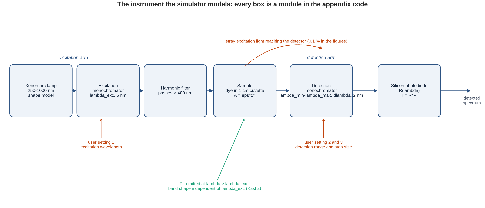
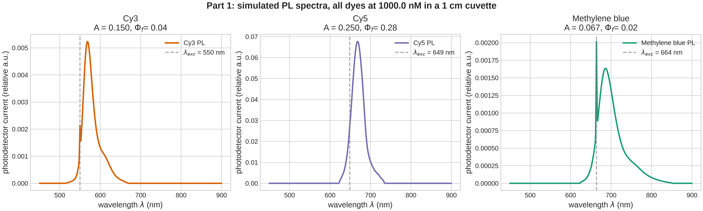
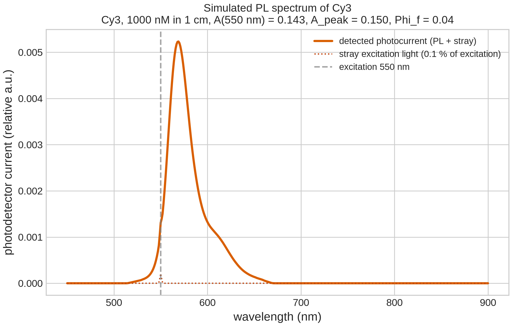
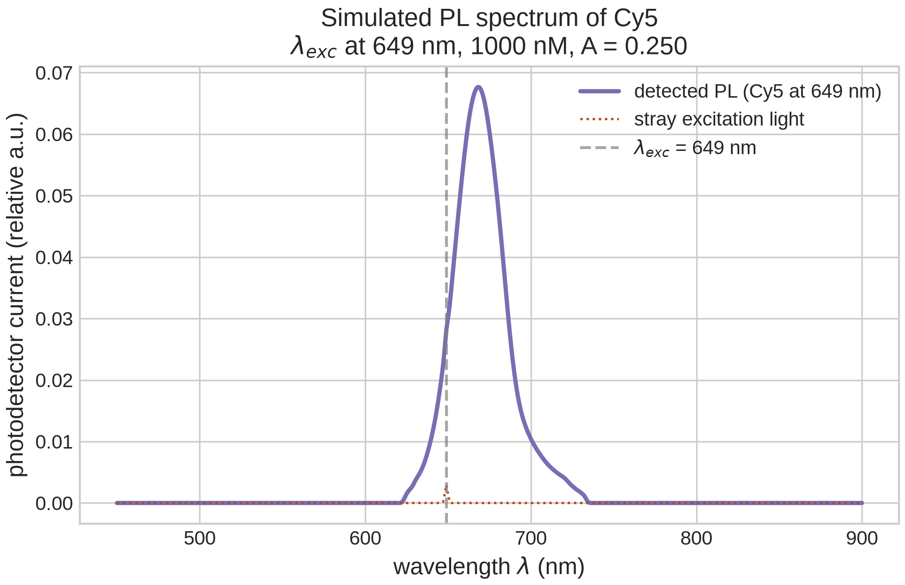
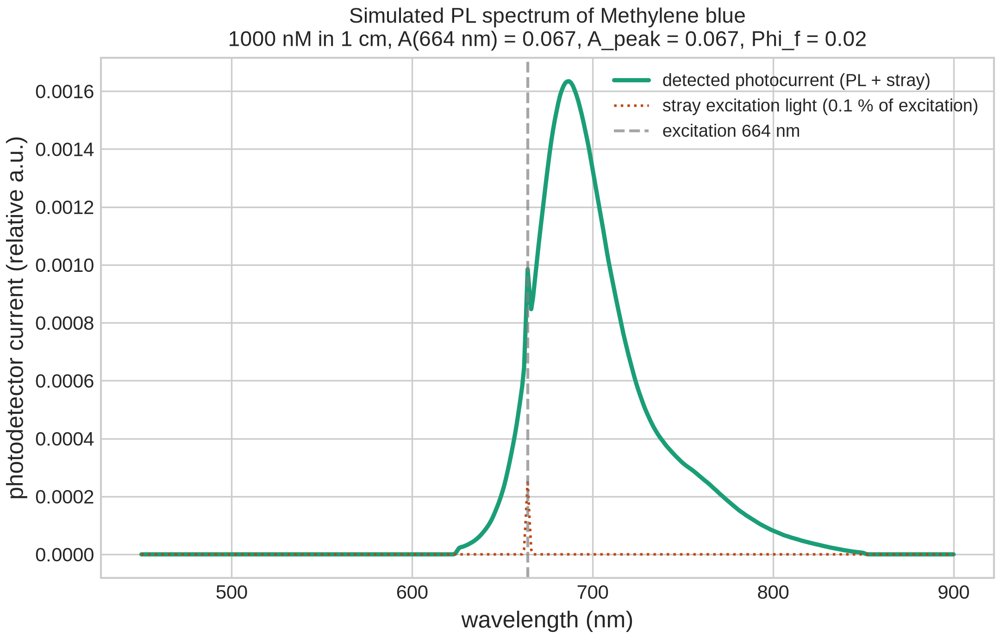
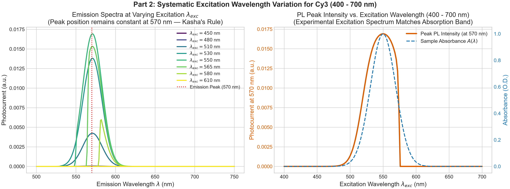
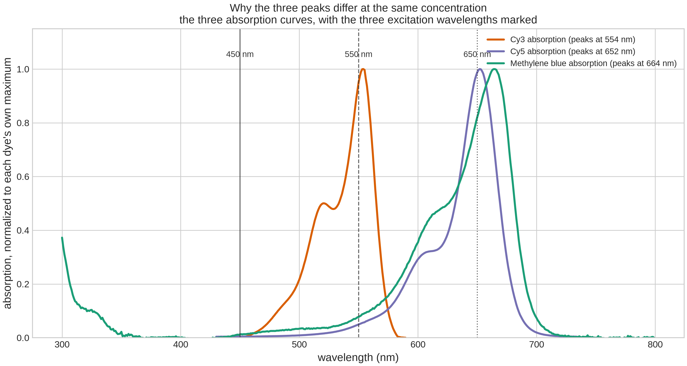
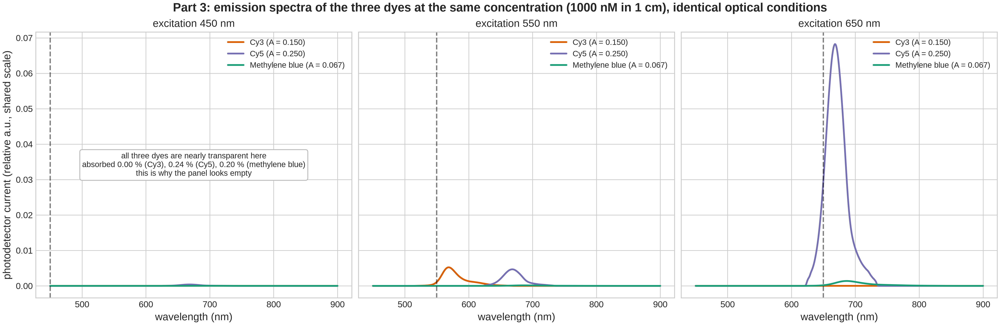
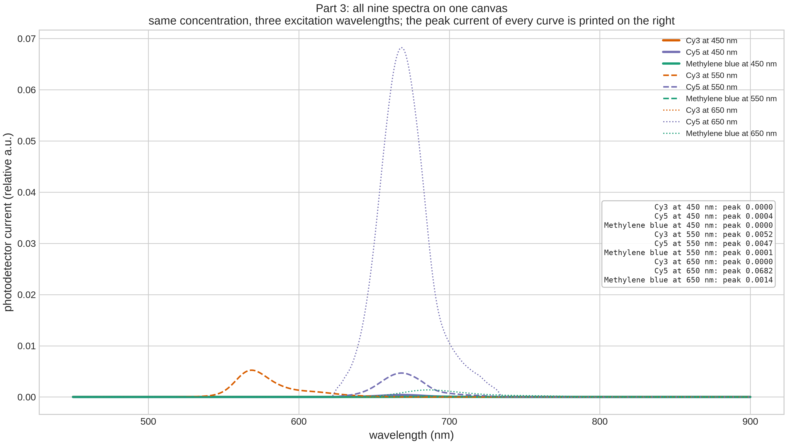

# PL spectrometer simulator

Simulator for a photoluminescence (PL) spectrometer, written for the quantum
physics section of the nano capsule class.

It models the instrument from the lab notes:

```
xenon lamp -> monochromator (lambda_exc) -> harmonic filter -> sample
                                                               |
                     photodetector <- monochromator (scan) <---+
```

## The assignment report

The report below is the submitted one, in markdown and without its code appendix (the PDF in
`report/` is the document that was handed in, code appendix included). It is not retyped: it is
generated from `report/generate_pdf_report.py`, the same source the PDF is built from, so the two
cannot drift. Regenerate it with `uv run python report/generate_readme.py`.

**Course:** Nanotechnology & Quantum Physics  |  **Topic:** instrument simulation, Kasha's rule, multi-dye spectroscopy

**Students:** Mohamed Oboda (2111011090)  |  Mert SOLMAZ (2311011039)

## 1. Design of the PL spectrometer and the three dye spectra (25%)



*Figure 1: the instrument the simulator models. Every box is a module in the appendix code: the lamp spectrum (sources.py), the monochromators and harmonic filter (sources.py), the dye database (samples.py, reference.py), the detector (detector.py) and the scan that connects them (spectrometer.py). The three user settings act where the drawing shows them. The instrument, the model and the analysis code were built with the AI tools named on the title page, working from the block diagram of the class session; every physical assumption, source datum and check is documented in the repository.*

### 1.1 The design.

A xenon arc lamp provides a broad continuum across the visible and near infrared. The excitation monochromator isolates the excitation wavelength λ<sub>exc</sub> with a 5 nm passband; a long-pass harmonic filter removes the second-order grating output below 400 nm, so the sample is not also illuminated at λ<sub>exc</sub>/2 from second-order diffraction. The beam crosses a 1 cm cuvette holding the dye. The emitted light is collected and scanned by a second monochromator, 2 nm passband, across the detection range [λ<sub>min</sub>, λ<sub>max</sub>] in steps of Δλ, and detected by a silicon photodiode whose responsivity *R*(λ) grows through the visible and cuts off near 1100 nm. A small fraction of the excitation light reaches the detector as stray light; the figures that include it use 0.1 % of the excitation power, which is what a double monochromator with a harmonic filter is expected to leave. Intensities are relative: the model reproduces spectra and relative intensities, not absolute radiometric values.

What the sample does is described by two bands per dye, absorption and emission, taken from measured data rather than from ideal Gaussians. The absorbed fraction follows the Beer-Lambert law, so the emitted power is *P*<sub>exc</sub>(λ<sub>exc</sub>) × [1 − 10<sup>−A(λ<sub>exc</sub>)</sup>] × Φ<sub>f</sub>, with *A* = ε·*c*·*l*. The emission band shape itself is independent of the excitation wavelength, which is the subject of section 2.

### 1.2 Sample database and baseline spectra.

Cy3 and Cy5 are the sulfoindocyanine dyes introduced as fluorescent labelling reagents by [3], and the model uses the vendor maxima, 550 nm for Cy3 and 649 nm for Cy5 [9]. The same vendor documentation names the lines the fluorescence literature conventionally uses, the 633 nm helium-neon and 647 nm krypton-argon lines [9]. Methylene blue is a phenothiazinium dye whose excited state is quenched both by internal conversion and by intersystem crossing [4, 6], which is why its quantum yield is the lowest of the three: the 0.04 that is often quoted for it is the ethanol value, and the aqueous value used here is the 0.02 reference-standard convention declared in section 4. The database holds the three dyes named in the task, at the same concentration (1 µmol/L in a 1 cm cuvette, so *A* = ε*c**l* differs between them: 0.150 for Cy3, 0.250 for Cy5, 0.067 for methylene blue). Each dye was excited at its own absorption maximum. The spectra below are the instrument output, not idealised curves: they carry the lamp and monochromator throughput, the 2 nm detection passband and the detector responsivity. Their peaks fall where the measured bands peak - 568.0 nm for Cy3, 668.0 nm for Cy5 and 685.0 nm for methylene blue on the digitized curves, read as 686 nm on the 1 nm scan grid - against the vendor maxima of 570, 670 and 685 nm: 2 nm for Cy3 and Cy5 and none at all for methylene blue. That difference is in the source data, not in the instrument: a symmetric passband widens a band without moving its centre.



*Figure 2: simulated PL spectra of Cy3 (λ<sub>exc</sub> = 550 nm), Cy5 (649 nm) and methylene blue (664 nm), all at 1 µmol/L in 1 cm, with the stray excitation line shown in each panel. Each panel has its own current scale; the peak absorbances differ by a factor of 3.7.*







*Figure 3: the same three measurements at full scale, one per dye - the screen captures the task asks for, taken as the simulator's own output written straight to an image file, with no post-processing: A(λ<sub>exc</sub>) and A<sub>peak</sub> and Φ<sub>f</sub> are printed in each title. Peak currents: Cy3 5.2 × 10<sup>-3</sup>, Cy5 6.8 × 10<sup>-2</sup>, methylene blue 1.6 × 10<sup>-3</sup> (relative units).*

## 2. Excitation wavelength from 400 nm to 700 nm (50%)

**2.1 What was done.** Cy3 was chosen because its absorption (550 nm) and emission (570 nm) both sit comfortably inside the detector's useful range and it is the best documented of the three dyes. The excitation wavelength was swept from 400 nm to 700 nm in 2 nm steps while the whole emission band was recorded with the detection monochromator set to 450-900 nm in 1 nm steps, and the plotted intensity is the integral of the emitted band over the detection range, not the height at one fixed wavelength: a fixed window stops watching the dye and starts watching the window as soon as λ<sub>exc</sub> moves past it.



*Figure 4: (left) emission spectra for six excitation wavelengths, all peaking at 568.0 nm with 28.0 nm FWHM; (right) the integrated PL intensity across the sweep, the model prediction P<sub>exc</sub>(λ)[1 − 10<sup>−A(λ)</sup>]Φ<sub>f</sub>, and the absorbance normalised to its own maximum. The two model curves lie on top of each other; the absorbance differs slightly because the intensity carries the xenon lamp spectrum as a weight. The left panel is the detected signal including stray light, so each curve carries a small spike at its own excitation wavelength; the sweep on the right uses the fluorescence alone, so stray light cannot contaminate it.*

### 2.2 What is observed.

1. **The emission band does not move.** Across every excitation wavelength that produces a signal the peak stays at 568.0 nm and the FWHM at 28.0 nm on the 1 nm scan grid, 28.6 nm on the digitized band, and this is Kasha's rule in the data rather than in prose. The overlay in Figure 4 shows six spectra between 470 nm and 560 nm; the sweep itself is non-zero from about 452 nm to 588 nm. 
2. **The height follows the absorbed light.** The measured integrated intensity reproduces *P*<sub>exc</sub>(λ)[1 − 10<sup>−A(λ)</sup>]Φ<sub>f</sub> to within 10<sup>-16</sup> of full scale, the numerical noise of the comparison. That agreement is a check on the implementation - the lamp spectrum, the two monochromator passbands, the detector responsivity and the integration all have to be right to reach it - and it is not evidence about the dye, which is why 2.3 says so again. The curve rises towards the absorption maximum and collapses when the absorption does. 
3. **Below about 450 nm the model reads zero absorption.** The strip it uses begins at 450 nm, and the same dye record's wider excitation strip gives 1.8 % of the peak at 450 nm and 0.2 % at 400 nm - absorbed fractions of 0.6 % and 0.07 % at the concentration used here - while the documented methanol spectrum gives 4.3 % at 450 nm, which is 1.5 % absorbed. All of that is far below what the figure can show, but none of it is zero (section 3.3 of the generated number table). So this end is a limit of the tabulated range rather than of the physics. (The 400 nm harmonic filter does not enter here: it only blocks wavelengths below 400 nm, which the sweep does not use.) 
4. **Above about 590 nm the simulation returns exactly zero**, for two different reasons. The strip the model uses was digitized over 450-590 nm, so between 590 and about 610 nm this is a limit of the data: the same record's corrected excitation strip runs to 649 nm and reads 0.38 % of the peak at 600 nm and 0.02 % at 610 nm. From about 620 nm to 700 nm the curve is flat because the dye is, not because the data stops - that strip returns zero there, and the documented methanol spectrum of the same chromophore, which does reach 700 nm, reads 0.20 % at 650 nm, an absorbed fraction of 0.07 % at the concentration used here (both in section 3.3 of the generated number table). A real instrument would record a weak, not vanishing, signal near 600 nm, and nothing measurable beyond it. 
5. **Stray light tracks the excitation wavelength.** With stray light enabled, the scattered line sits exactly at λ<sub>exc</sub> and moves with it, which is why the harmonic filter and the second monochromator exist.

### 2.3 Do the observations fit the literature?

**Yes, and the reason is a separation of timescales.** Absorption promotes the molecule to higher vibrational levels of the first excited singlet state, or to higher electronic states. Internal conversion and vibrational relaxation then remove that excess energy in about 10<sup>-13</sup>-10<sup>-12</sup> s, the range the fluorescence literature gives for those two processes [2, §1.4.2], while fluorescence from Cy3 takes of order 0.2-2 ns [5]. The rule itself is Kasha's, stated for states in 1950 [1]. Emission is therefore two to four orders of magnitude slower than the relaxation, so every excited molecule emits from the same thermalized level, S<sub>1</sub>(v = 0), whatever photon it absorbed. The emission spectrum is therefore fixed in shape, position and width, and only the number of excited molecules - that is, the absorbed light - changes with λ<sub>exc</sub>. The two dyes in our own database illustrate the same chain-length argument: Cy3 is a trimethine cyanine absorbing at 550 nm and Cy5 a pentamethine at 649 nm, so two extra methine units shift the band by 99 nm in our own data, which is the free-electron model of the cyanine chain in practice [7]. That is Kasha's rule as Kasha stated it for states [1] and as Lakowicz states it for wavelength, in the section whose title says exactly that [2, §1.3.2].

**The intensity behaviour is the excitation spectrum, with one honest caveat.** The absorbed photon rate follows Beer-Lambert, so *I*<sub>PL</sub> ∝ *I*<sub>0</sub>(λ<sub>exc</sub>)[1 − 10<sup>−ε(λ<sub>exc</sub>)*c**l*</sup>]Φ<sub>f</sub>, which for a dilute sample is ∝ ε(λ<sub>exc</sub>)Φ<sub>f</sub>. The curve in Figure 4 (right) therefore tracks the absorption band, but the lamp spectrum *I*<sub>0</sub>(λ) sits inside that expression, so the two curves are similar rather than identical - the residual difference visible in the figure is the xenon lamp, not an error. Correcting for *I*<sub>0</sub>(λ) is what an instrument does when it records a quantum-corrected excitation spectrum.

**A note on what this simulation can and cannot demonstrate.** The invariance of the band with λ<sub>exc</sub> is built into the model, because that is what the timescale argument above requires. What the sweep verifies is the consequence: that the absorbed fraction, and nothing else, depends on the excitation wavelength, and that the resulting intensity agrees with the Beer-Lambert prediction to machine precision. In that sense the simulator is a test of the consequences of Kasha's rule rather than a discovery of it. The assumption is also falsifiable, and cheaply so: a drift of 0.05 nm of emission peak per 1 nm of excitation wavelength would put the peak at 563.0 nm under 450 nm excitation and 575.5 nm under 700 nm, so the left panel of Figure 4 would be a fan of six different peaks instead of six curves lying on one another. Nothing in the sweep would look the same.

**The Stokes shift.** Absorption and emission maxima are separated by 20 nm, which is 638 cm<sup>-1</sup> calculated from the quoted 550 and 570 nm values (the digitized curve peaks, 554 and 568 nm, give 14 nm and 445 cm<sup>-1</sup>; the figure is quoted from the sourced maxima). The shift is the Franck-Condon and solvent reorganisation energy, and it is why the emission sits at longer wavelength than the absorption, never at shorter.

## 3. The three dyes on one graph at 450, 550 and 650 nm (25%)

**3.1 The colours come from the absorption bands.** All three dyes were simulated at the same concentration, 1 µmol/L in a 1 cm cuvette, so their peak absorbances differ by their extinction coefficients: 0.150 (Cy3), 0.250 (Cy5) and 0.067 (methylene blue). "The same concentration" is not "the same absorbance" - that is the first thing to say about this question. The second is that each dye sits at a different point of its own absorption curve, shown in Figure 5.



*Figure 5: the three absorption bands, each normalised to its own maximum, with the three excitation wavelengths marked. At 550 nm Cy3 is near its maximum (its curve peaks at 554 nm) while Cy5 and methylene blue are on their rising edges; at 650 nm Cy5 and methylene blue absorb while Cy3 has nothing left above its band.*



*Figure 6: the same graph for each excitation wavelength - 450 nm (left), 550 nm (centre), 650 nm (right) - on one shared scale in relative units, which is what makes the comparison meaningful. The legend gives A(λ<sub>exc</sub>) for each curve in that panel.*



*Figure 7: all nine spectra on a single canvas, with the peak current of every curve printed beside it. The empty-looking curves are not an error: they are the dyes that do not absorb at that wavelength.*

### 3.2 Why the peaks are not the same.

The peak height is a product of four terms, and the first is the one the question is looking for:

**(1) How much light the dye absorbs at λ<sub>exc</sub>.** *A*(λ<sub>exc</sub>) = ε(λ<sub>exc</sub>)*c**l*, and ε at a given wavelength depends entirely on where that wavelength falls in the dye's own band. At 550 nm Cy3 absorbs 28.0 % of the incident light while Cy5 absorbs 2.81 % and methylene blue 1.19 %. At 650 nm it is Cy5 that absorbs 43.4 %, methylene blue 11.9 %, and Cy3 nothing in the model: its tabulated band ends at 590 nm. 
**(2) The quantum yield.** Of the photons absorbed, only the fraction Φ<sub>f</sub> is emitted: 0.28 for Cy5, 0.04 for Cy3, 0.02 for methylene blue in water. This is why the 550 nm panel is not lopsided in favour of Cy3: Cy3 absorbs ten times more light than Cy5 there, yet the two peaks come out within 12 % of each other, because Cy5 converts absorbed photons into fluorescence seven times more efficiently. 
**(3) The detector's wavelength dependence.** A silicon photodiode of a given quantum efficiency has a responsivity proportional to wavelength [8], and this one is about a third higher at methylene blue's emission (686 nm) than at Cy3's (568 nm), so equal emitted power at those two wavelengths does not give equal photocurrent. 
**(4) The width of the emission band.** Measured on the digitized bands, Cy3, Cy5 and methylene blue are 28.6, 33.4 and 48.6 nm wide (the simulated curves read 28, 32 and 47 nm on a 1 nm grid); a published Cy5 bandwidth, 37.4 nm for an aptamer conjugate [10], is 4 nm wider than the 33.4 nm measured here, and no published bandwidth for Cy3 was found at all. This width is not a further factor inside the peak heights above: the model draws each band normalized to its own maximum, so a peak here is set by the absorbed fraction and the quantum yield, and the width shows up in the integral. It does enter the moment the comparison is made at equal emitted power, which is how a quantum yield is normally measured: the same photon budget spread over a wider band gives a lower peak, and methylene blue is the broadest of the three as well as the weakest emitter.

**One honest caveat about 450 nm.** There the model returns exactly zero absorption for Cy3, because its tabulated band begins at 450 nm and reads zero at that edge, against 0.24 % for Cy5 and 0.20 % for methylene blue. The wider strip in the same record puts Cy3 near 0.6 % at 450 nm (section 3.3 of the generated number table), which is more than either of the other two - so the left panel of Figure 6 is nearly empty because all three dyes are effectively transparent there, not because the simulation failed. The comparison the question is really asking about is the 550 nm and 650 nm panels, where the dyes that absorb are also the dyes that light up.

**Peak currents for the record** (relative units, 1 µmol/L, 1 cm): at 450 nm Cy3 0.00000, Cy5 0.00040, methylene blue 0.00002; at 550 nm Cy3 0.00523, Cy5 0.00468, methylene blue 0.00015; at 650 nm Cy3 0.00000, Cy5 0.06824, methylene blue 0.00138.

## 4. References

Every entry below was checked to resolve, and each claim is attached to the work that carries it. Where a DOI circulates in a wrong form, the corrected one is given. Where a work is closed-access and could not be read beyond its table of contents, the citation points to the section whose stated subject carries the claim, and the claim is phrased as textbook content rather than as a quotation from a page that was not read.

- [1] M. Kasha, "Characterization of electronic transitions in complex molecules", *Discussions of the Faraday Society* **9** (1950) 14-19. DOI [10.1039/DF9500900014](https://doi.org/10.1039/DF9500900014). (The rule stated for states.)

- [2] J. R. Lakowicz, *Principles of Fluorescence Spectroscopy*, 3rd ed., Springer, 2006. DOI [10.1007/978-0-387-46312-4](https://doi.org/10.1007/978-0-387-46312-4). (§1.3.2, "Emission Spectra Are Typically Independent of the Excitation Wavelength", p. 7; §1.4.2, "Timescale of Molecular Processes in Solution", p. 12.)

- [3] R. B. Mujumdar, L. A. Ernst, S. R. Mujumdar, C. J. Lewis and A. S. Waggoner, "Cyanine dye labeling reagents: sulfoindocyanine succinimidyl esters", *Bioconjugate Chemistry* **4** (1993) 105-111. DOI [10.1021/bc00020a001](https://doi.org/10.1021/bc00020a001). (Introduction of the sulfoindocyanine succinimidyl esters; the vendor values for the maxima used here are in [9].)

- [4] E. M. Tuite and J. M. Kelly, "Photochemical interactions of methylene blue and analogues with DNA and other biological substrates", *Journal of Photochemistry and Photobiology B: Biology* **21** (1993) 103-124. DOI [10.1016/1011-1344(93](https://doi.org/10.1016/1011-1344(93))80173-7. (Excited-state behaviour of methylene blue.)

- [5] R. Berrocal-Martin et al., *Journal of Physical Chemistry B* **129** (2025) 11626-11635. DOI [10.1021/acs](https://doi.org/10.1021/acs).jpcb.5c03845. (Fluorescence lifetimes of sulfo-Cy3 on DNA constructs in Tris buffer, read from the paper's own text: about 0.2 ns for the free dye, with components of 0.6-1.1 ns and 1.5-2.5 ns.)

- [6] L. M. Moreira, J. P. Lyon, A. P. Romani, D. Severino, M. R. Rodrigues and H. P. M. de Oliveira, "Phenotiazinium dyes as photosensitizers in photodynamic therapy: spectroscopic properties and photochemical mechanisms" (title and spelling as printed), in *Advanced Aspects of Spectroscopy*, InTech, 2012, ch. 14. DOI [10.5772/48087](https://doi.org/10.5772/48087). (Methylene blue: the singlet state decays by internal conversion and by intersystem crossing, with a triplet yield of 0.52, which is why its quantum yield is the lowest of the three.)

- [7] H. Kuhn, "A quantum-mechanical theory of light absorption of organic dyes and similar compounds", *Journal of Chemical Physics* **17** (1949) 1198-1212. DOI [10.1063/1](https://doi.org/10.1063/1).1747143. (Free-electron model of the cyanine chain, eq. (8); the report uses it for the chain-length argument and quotes the shift from our own data - 550 nm for the trimethine Cy3 against 649 nm for the pentamethine Cy5.)

- [8] Hamamatsu Photonics, "Si photodiodes", technical note KSPD9001E04, sec. 2-3, eq. (2-3), which prints the quantum-efficiency form QE = (S × 1240 / λ) × 100 %; equivalently the responsivity of a detector of quantum efficiency η is ηλ[µm]/1.24 A/W. A technical note has no DOI of its own; for the same relation from a citable source, RP Photonics, "Responsivity", DOI [10.61835/xal](https://doi.org/10.61835/xal), an article on responsivity and how it relates to quantum efficiency.

- [9] Dye spectra and molar extinction coefficients, from the vendor documentation kept in *data/raw/*. Cy3: the Cytiva Cy3 instructions-for-use sheet and the Cy3 maleimide specification sheet 28954681, which print absorbance maximum 550 nm, emission maximum 570 nm, and 150 000 M<sup>-1</sup>cm<sup>-1</sup> at 552 nm in the labelling formula. Cy5: the maleimide sheet 28954683, which prints 649 nm, 250 000 M<sup>-1</sup>cm<sup>-1</sup> at 650 nm, and 670 nm. Methylene blue: the PhotochemCAD record PSW009, whose own reference is JACS Au (DOI [10.1021/jacsau](https://doi.org/10.1021/jacsau).5c01463), and the OMLC/Prahl measured spectrum. The same vendor documentation names the conventional Cy5 excitation lines, the 633 nm helium-neon and 647 nm krypton-argon lines. The full source table, with a confidence for each value and the raw files, is the data-sources appendix of this report, and the raw files themselves are in *data/raw/*.

- [10] A published Cy5 emission bandwidth, used only as a cross-check on the width measured here: *Biosensors* **13** (2023) 876, Table 2, DOI [10.3390/bios13090876](https://doi.org/10.3390/bios13090876) (open access, PMC10526137), which gives an Aptamer-Cy5 emission maximum at 665.0 nm with a 37.4 nm FWHM.

**Declared limitations.** No primary source was found for the widely repeated methylene blue extinction coefficient of 95,000 M<sup>-1</sup>cm<sup>-1</sup>, so it is not used: the pack carries 67,000 (PhotochemCAD, water), 74,028 (OMLC) and 107,800 for the deconvoluted monomer. The quantum yield of methylene blue in water, 0.02, is the value used in photodynamic-therapy work, where it serves as a reference standard; the measured value is 0.04 in ethanol (the PhotochemCAD record I12 kept in *data/raw/*), and some readable sources also quote 0.04 for water, so the range is 0.02-0.04 rather than a single number. The emission bandwidths quoted here are measured on the digitized bands rather than taken from the literature; a published Cy5 emission FWHM of 37.4 nm [10], for an aptamer conjugate, is 4 nm wider than the 33.4 nm measured here, and no published bandwidth for Cy3 was found at all. The FPbase records from which the Cy3 and Cy5 bands are digitized do not state their provenance; the fully documented curves for the same chromophores are the PhotochemCAD methanol spectra kept in *data/raw/*. Section 3.1 of the generated number table tests how much any of this could move the result: re-run at the top of both unverified ranges at once, methylene blue reaches 0.00429 at 650 nm against Cy5's 0.06824 and Cy3's 0.00523 at 550 nm, so the ranking between the three dyes does not depend on the numbers that could not be sourced.

## User settings

| setting | flag | meaning |
| --- | --- | --- |
| `lambda_exc` | `--lambda-exc` | excitation wavelength selected from the xenon lamp |
| `lambda_min`, `lambda_max` | `--range` | PL detection range |
| `delta lambda` | `--dlambda` | step size of the detection scan |
| sample | `--sample` | dye from the sample database |

## Sample database

| key | dye | absorption | emission | quantum yield | molar extinction |
| --- | --- | --- | --- | --- | --- |
| `cy3` | Cy3 | 550 nm | 570 nm | 0.04 (free dye in PBS) | 150,000 |
| `cy5` | Cy5 | 649 nm | 670 nm | 0.28 (aqueous) | 250,000 |
| `methylene-blue` | Methylene blue | 664 nm | 685 nm | 0.02 (water) | 67,000 |

The quantum yields are the honest ones for the stated solvent, and they matter:
the same Cy3 chromophore is reported at 0.10-0.31 when it is conjugated or in a
low-polarity environment, and methylene blue is 0.04 in ethanol but 0.02 in
water. Always quote the number together with the solvent.

Two databases are available:

- `--database reference` (the figures use this; the CLI default is `auto`, which
  falls back to the model if the pack is missing): measured absorption and emission bands from
  `data/reference_spectra.json` — digitized vendor/database/paper curves, so the
  simulated spectrum has the real band shape, including the cyanine vibronic
  shoulder.
- `--database model`: Gaussian bands with the same centres, widths and quantum
  yields (the compact model used in `plsim/samples.py`).

## Install and run

```
uv sync
uv run python -m plsim --list-samples
uv run python -m plsim --sample cy5 --lambda-exc 649 --range 600 780 --dlambda 0.5 --concentration 1e-6
uv run python -m plsim --sample methylene-blue --lambda-exc 664 --range 550 800 --ideal --concentration 1e-6
uv run python -m plsim --sample cy5 --database model --lambda-exc 649 --range 600 780 --concentration 1e-6
```

The figure is written to `out/` unless `--show` is given. `--ideal` removes the
stray excitation light, so only the PL spectrum is left.

The absorbance the model uses is `A_peak = epsilon * c * l`. `--concentration`
(mol/L) with `--path-length` (cm) sets it from the dye's extinction coefficient;
`--peak-absorbance` sets it directly. Equal concentration is *not* equal
absorbance: at 1 umol/L in a 1 cm cuvette the three dyes sit at A = 0.150, 0.250
and 0.067, which is why the third question has a non-trivial answer.

## Experiments

```
uv run python report/generate_assignment_figures.py                  # all three questions
uv run python report/generate_assignment_figures.py --only part2     # the Cy3 sweep
uv run python report/generate_numbers.py                             # rewrite report/numbers.md
uv run python report/generate_readme.py                               # rewrite this README's report part
uv run python report/generate_pdf_report.py                           # rebuild the submission PDF
uv run python report/check_pdf.py                                     # gate the PDF before uploading
```

The figures fix their own optical conditions so that every number in the report
can be traced: same concentration for all three dyes (1 umol/L in a 1 cm cuvette),
detection range 450-900 nm, stray excitation light 0.1 % of the excitation power.
They are the "screenshots" the assignment asks for:

| figure | question |
| --- | --- |
| `part1_instrument_diagram.png` | 1 - the design itself |
| `part1_combined_overview.png`, `part1_cy3.png`, `part1_cy5.png`, `part1_methylene-blue.png` | 1 - the three dye spectra |
| `part2_cy3_excitation_sweep.png` | 2 - the 400-700 nm sweep |
| `part3_absorption_overlay.png` | 3 - why the peaks differ |
| `part3_three_dyes_comparison.png`, `part3_single_canvas_overlay.png` | 3 - three dyes on one graph, both readings |

`report/numbers.md` is generated from the code and the reference pack, so the report
never retypes a number by hand and the text cannot drift away from the code.
`report/generate_pdf_report.py` builds the submission PDF from the figures, the
numbers and the source files themselves.

## What is modelled, and how real it is

- **Xenon lamp**: smooth approximation of the arc continuum plus the strongest
  xenon lines. A shape model, not a measured lamp spectrum.
- **Monochromator**: Gaussian passband, given bandwidth and throughput. The
  excitation monochromator is 5 nm, the detection monochromator 2 nm.
- **Harmonic filter**: passes wavelengths above 400 nm and blocks what is below,
  which is where the second-order (harmonic) grating output lands.
- **Sample**: one absorption band and one emission band per dye, taken from the
  measured reference pack by default. Absorbed fraction from the Beer-Lambert
  law, so the PL intensity is `P_exc * (1 - 10^-A(lambda_exc)) * QY`.
  The emission band does **not** depend on the excitation wavelength: a molecule
  that has absorbed a photon relaxes to the bottom of S1 before it emits, so
  sweeping `lambda_exc` changes only how much light is absorbed, never the shape
  or position of the spectrum (Kasha's rule, the subject of question 2).
  Anti-Stokes emission is deliberately not modelled: it is weak, and adding a
  Boltzmann factor on top of a measured band would double-count the vibronic
  envelope that is already in the measured band shape.
- **Photodetector**: silicon responsivity shape, weak in the UV, peaking near
  880 nm, cut off past about 1100 nm. Photocurrent `I = R(lambda) * P`.
- **Stray excitation light**: a small fraction of the excitation beam (1 % by
  default) reaches the detector. When `lambda_exc` lies inside the detection
  range it appears as a sharp line on top of the PL spectrum, which is what the
  filter and the second monochromator are there to suppress.

All powers and currents are in relative units: the model gives spectra and
relative intensities, not absolute radiometric values.

## Reference data and sources

`data/reference_spectra.json` holds the measured reference pack for the three
dyes: absorption and emission maxima, band FWHMs measured on the shipped curves,
quantum yields with their solvent, molar extinction coefficients, Stokes shifts,
notes and, for each dye, a digitized absorption and emission curve at 1 nm.
`data/SOURCES.md` gives a source and a confidence for every number, plus the
list of what could not be verified; `data/raw/` keeps the raw source data so
every digitized curve can be re-derived.

Where the sources disagree, the pack says so instead of hiding it. The main
open points:

- Cy3 and Cy5 curves come from FPbase, which does not state the provenance of
  its dye records; the fully documented curves for the same chromophores are
  PhotochemCAD records in methanol, kept in `data/raw/`.
- No digitized Cy3/Cy5 curve in aqueous buffer was obtainable (vendor
  SpectraViewer and several publishers block automated access), so the aqueous
  numbers are vendor values.
- Emission FWHM is instrument-limited: the PhotochemCAD emission curve was
  recorded with a 4.25 nm bandwidth.
- Methylene blue's widely quoted extinction coefficient of 95,000 had no
  citable primary source and was left out.
- Cy5 in methanol is reported at 0.4 by PhotochemCAD, while an integrating-sphere
  measurement gives 0.17.

## Layout

```
plsim/bands.py          Gaussian and tabulated band shapes
plsim/sources.py        xenon lamp, monochromator, harmonic filter
plsim/samples.py        dye database, concentration, absorbance
plsim/reference.py      loader for the measured reference pack
plsim/detector.py       silicon photodiode
plsim/spectrometer.py   the instrument, producing a PL scan
plsim/analysis.py       excitation scans and their model checks
plsim/plot.py           matplotlib rendering
report/settings.py      optical conditions shared by figures and numbers
plsim/cli.py            command line interface
data/                   measured reference pack + sources + raw source data
report/                 assignment figures, numbers, and the report itself
tests/                  the physics the report claims (uv run pytest)
TASK.md                 the assignment, its requirements and the open items
```
